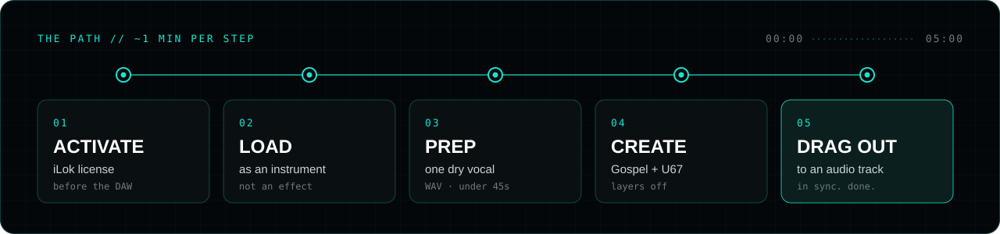

<p align="center">
  
</p>

<p align="center">
  
  
  
  
</p>

<p align="center">
  <b>One dry vocal in. A full choir out.</b><br>
  An agent skill that coaches a producer from installed plugin to a playing choir, one step at a time, and fixes the six setup problems that actually happen.
</p>

<p align="center">
  <a href="../../releases/latest"><b>Download the skill</b></a>
  &nbsp;·&nbsp;
  <a href="i-am-choir-first-choir/SKILL.md"><b>Read SKILL.md</b></a>
  &nbsp;·&nbsp;
  <a href="#troubleshooting"><b>Troubleshooting</b></a>
  &nbsp;·&nbsp;
  <a href="https://amiaudio.io/beta"><b>Windows beta</b></a>
</p>

---

## The path

<p align="center">
  
</p>

The agent coaches **one step at a time** and waits for a yes before moving on. No walls of text, no skipping ahead.

| # | Step | What the agent makes sure of |
|:-:|---|---|
| `01` | **Activate** | iLok license is active **before** the DAW opens, on the right iLok User ID |
| `02` | **Load** | I AM CHOIR is on an **instrument** track, not an effect slot |
| `03` | **Prep** | One singer, one part, dry WAV or AIFF, under 45 seconds, silence trimmed |
| `04` | **Create** | `Gospel + U67` for sung lines, `Shout` for shouts, layers off, then **Create Vocals** |
| `05` | **Drag out** | Output dragged to an audio track and lined up. Done when it plays in sync. |

> [!WARNING]
> Never bounce the instrument track. The preview does not play in sync with the timeline, so a bounce will not capture the choir. Always drag the output to an audio track.

## Quickstart

```bash
# 1. Grab the latest release zip (or build it yourself)
cd i-am-choir-first-choir-skill
zip -r i-am-choir-first-choir.zip i-am-choir-first-choir

# 2. Upload the zip as a skill in your agent (Perplexity Computer, Claude, etc.)

# 3. Say any of these
"help me make my first choir"
"I AM CHOIR isn't showing up in Logic"
"my license is missing"
```

## Troubleshooting

Matched by symptom, mapped to the step where it breaks.

| Symptom | Breaks at | Fix |
|---|:-:|---|
| Can't find the plugin | `02` | Search "AM I AUDIO." Confirm iLok activation, restart the DAW, rescan plugins. |
| License is missing | `01` | iLok User ID in License Manager must match checkout. Check Available and All Licenses. |
| Bought after the trial | `01` | Paid license is separate. Close the DAW, activate the paid license. |
| Sound is glitchy | `03` | It's the input. One dry voice, no effects, trim silence, layers off. |
| Only the main choir came out | `04` | Select Octave Up, Octave Down or harmonies **before** Create Vocals. |
| Export is stretched | `05` | Kill tempo following: Warp off (Ableton), Elastic Audio None (Pro Tools), Follow Tempo off (Studio One). |

Still stuck? The agent escalates to **support@amiaudio.io** (order email + iLok User ID) or a 15-minute setup call. It never invents fixes beyond the guide.

## DAW cheat sheet

| DAW | Load it here |
|---|---|
| Logic Pro | New Software Instrument track, `AU Instruments > AM I AUDIO` |
| Pro Tools | Instrument track, then `Other` in the insert menu |
| Ableton Live | Browser search: `I AM CHOIR` or `AM I AUDIO` |
| Studio One, FL, others | Plugin search: `AM I AUDIO` |

## What's inside

```text
i-am-choir-first-choir-skill/
├── i-am-choir-first-choir/
│   ├── SKILL.md                              # the agent instructions
│   └── assets/
│       └── first-choir-in-5-minutes.docx     # one-page guide to send customers
└── .github/
    ├── assets/                               # banner + flow graphics
    └── workflows/release.yml                 # tag v* and the zip ships itself
```

## Shipping a new version

```bash
git tag v1.1 && git push origin v1.1
```

GitHub Actions zips the skill folder and attaches it to a new release automatically, so the **Download** link always points at the latest build.

---

<p align="center">
  <sub>Built by <a href="https://github.com/nickmerich">@nickmerich</a> for <b>AM I AUDIO</b>. "If Nick can make a choir in 5 minutes, you can."</sub>
</p>
